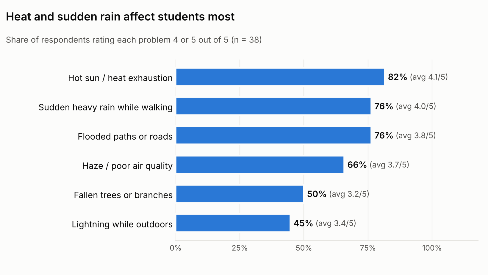
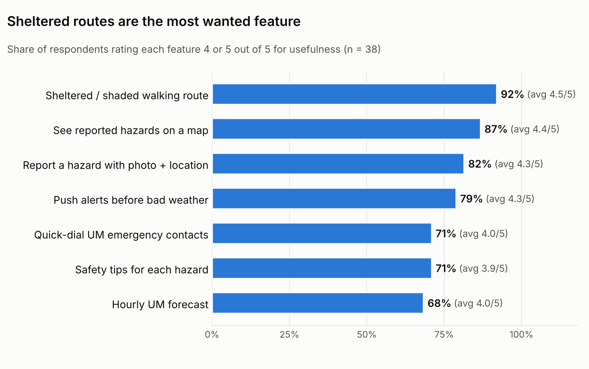

# Stakeholder Survey Findings — CuacaUM

| | |
|---|---|
| **Prepared by** | Ammar |
| **Week** | 5 |
| **Responses** | 38 (target was 30+) |
| **Collected** | 22 Oct – 1 Nov 2026, Google Form |
| **Raw data** | `docs/survey/survey_responses_anonymised.csv` (phone numbers and timestamps removed) |

**In one line:** weather disrupts most students' campus plans, heat and sudden rain hurt the most, most walking routes are barely sheltered, and the features students want most are **sheltered routes**, **hazard reports on a map** and **push alerts**. 95% say they would install the app.

---

## 1. Who answered

- **All 38 are undergraduates.** 82% (31) are based at **FSKTM** (Computer Science & IT).
- **Where they stay:** 42% off campus and far away (drive/LRT/bus), 37% in a residential college, 21% off campus nearby.
- **How they get around campus:** 50% the UM shuttle bus, 26% their own car or motorcycle, 24% walking.
- **Time walking outdoors on a weekday:** 45% walk 21–40 minutes, 11% more than 40, 26% 10–20 and 18% under 10. So **56% walk outdoors for more than 20 minutes a day**.

## 2. Weather really does disrupt campus life

- Asked how often weather disrupted their plans last semester (1–5), the average was **3.6**, and **53% answered 4 or 5**. Only 1 person said "never".
- **What they did when caught out:** 58% walked or ran through it, 58% waited under shelter, 34% **missed or were late for class**, 34% took a longer covered route, and 32% called an e-hailing ride.
- **42% don't check the weather at all.** The rest use a phone weather app (45%), social media or group chats (34%), or friends (32%). Only 16% get it from UM emails and 5% from MetMalaysia.

## 3. Which problems hurt most

| Problem | Rated 4–5 | Average (1–5) |
|---|---|---|
| Hot sun / heat exhaustion | 82% | 4.1 |
| Sudden heavy rain while walking | 76% | 4.0 |
| Flooded paths or roads | 76% | 3.8 |
| Haze / poor air quality | 66% | 3.7 |
| Fallen trees or branches | 50% | 3.2 |
| Lightning while outdoors | 45% | 3.4 |

**Heat is the top problem**, just ahead of sudden rain and flooding. Haze matters to two-thirds of respondents.

## 4. Routes and shelter

- **Most-walked places:** FSKTM (79%), UM Central (53%), Library (39%), LRT Universiti (29%), KPS (26%), DTC (24%), KK8 (18%).
- **Most common route:** residential college (KK5, KK8, KK10, KK12, KK13) → FSKTM, often **via the T815 / T789 bus stops**. LRT Universiti → FSKTM by bus is the other common route.
- **How sheltered is that route?** 34% almost none, 26% less than half, 29% more than half, 5% almost all. So **60% walk routes that are mostly unsheltered**.
- **Would they take a longer, more sheltered route?** 50% yes (5–20 extra minutes), 37% only when it's raining or very hot, 13% no. So **87% would take a detour at least some of the time**.
- **Spots that feel unsafe or uncomfortable** (free text): unsheltered and narrow roads, **bus stops** (too small for the crowd in heavy rain), around **KPS** (flooding), in front of the **Faculty of Science / Law**, **FSKTM parking**, the walk from **FSKTM to KK7**, **DTC**, and **KK10 Block B** (no roof between the laundry and the block).

## 5. What students want from the app

| Feature | Rated 4–5 | Average | Picked as the one they'd use most |
|---|---|---|---|
| Sheltered / shaded walking route | 92% | 4.5 | 24% |
| See reported hazards on a map | 87% | 4.4 | 8% |
| Report a hazard with photo + location | 82% | 4.3 | 3% |
| Push alerts before bad weather | 79% | 4.3 | **34%** |
| Quick-dial UM emergency contacts | 71% | 4.0 | 3% |
| Safety tips for each hazard | 71% | 3.9 | 3% |
| Hourly UM forecast | 68% | 4.0 | 26% |

- **Every feature averages 3.9 or higher**, so no planned module is unwanted.
- **Push alerts are the single most-wanted feature** (34% picked it as their top one), and **82% prefer alerts as push notifications** (16% in-app only, 3% email).
- **95% would install the app:** 34% definitely, 61% probably, 5% not sure, nobody said no.

## 6. Stories from respondents

- Walking to class from a residential college in sudden heavy rain, a passing car splashed water all over them.
- In heavy rain the bus stop was too crowded to shelter under, so they waited further away and **missed the bus**.
- Heavy rain made them **late for class**, or forced them to take the bus instead of walking.
- KPS flooded.
- The one feature request: **more sheltered roads**.

## 7. What this means for each module

| Module | Finding | What to do |
|---|---|---|
| **M1 Weather** | 42% never check the weather; only 5% use MetMalaysia | Make the Home screen status banner the main thing users see; don't expect them to open the forecast |
| **M2 Alerts** (Zi Hao) | Push alerts are the #1 pick; 82% want push notifications | Turn rain and heat alerts **on by default** |
| **M3 Tips** (Ammar) | Heat is the top pain point; tips are rated lowest of the features (3.9) | Show tips **inside alerts and on the Home card**, not just on a separate screen. Keep them short. Add v2 tips for bus-stop crowding, road splashing and leaving early when rain is forecast |
| **M4 Routing** (Daya) | Sheltered routes are the most wanted feature (92%); 60% walk mostly unsheltered routes; 87% accept detours | Prioritise these nodes in `campus_graph.json`: FSKTM, UM Central, Library, LRT Universiti, KPS, DTC, KK5/KK8/KK10/KK12/KK13, bus stops T815 and T789 |
| **M5 Hazards** (Intan) | Flooding rated 3.8; reporting and the hazard map rated 4.3–4.4 | Flood should be the first category; KPS and bus stops are likely hotspots |
| **M7 Emergency** (Arieth) | Quick-dial rated 4.0 | Keep it one tap from Home |

## 8. Limitations

- **The sample is skewed:** all undergraduates, and 82% are from FSKTM, so routes around FSKTM are over-represented and staff aren't represented at all.
- **38 responses** is enough for a class project but too small to compare subgroups (e.g. walkers vs bus users).
- Ratings are self-reported, and people who care about weather were probably more likely to answer.
